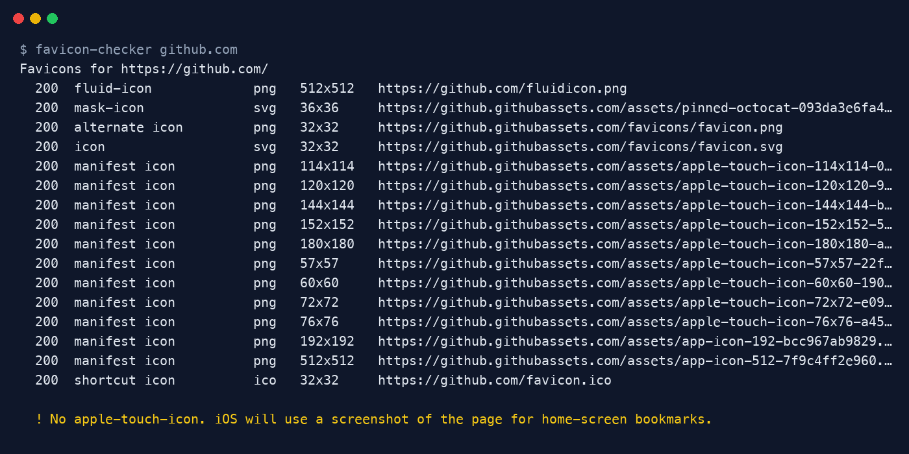

<div align="center">

# Favicon Checker

**Find out which favicon Google, browsers and iOS actually get from your site.**

[](https://github.com/ksanyok/favicon-checker/actions/workflows/ci.yml) [](LICENSE)   [](https://promopilot.link/en/tools/favicon-checker.php?utm_source=github&utm_medium=repo&utm_campaign=tools&utm_content=favicon-checker)

**[▶ Use the free online version — no install, no sign-up](https://promopilot.link/en/tools/favicon-checker.php?utm_source=github&utm_medium=repo&utm_campaign=tools&utm_content=favicon-checker)**

</div>

`favicon-checker` downloads a page, finds every icon it declares — `<link rel="icon">`, `shortcut icon`, `apple-touch-icon`, icons listed in the web app manifest and the implicit `/favicon.ico` — then fetches each file and reads its **real** format and pixel size from the image header. You get a list of what is actually served and a short list of problems to fix.



## What it checks

- Every `<link>` whose `rel` contains `icon` (including `apple-touch-icon`, `apple-touch-icon-precomposed`, `mask-icon`), resolved against `<base href>`
- Icons from the web app manifest (`<link rel="manifest">`), and whether it lists 192×192 and 512×512 for installable PWAs
- `/favicon.ico` at the site root — many crawlers and RSS readers request it directly
- HTTP status and content type of each icon file (404s, HTML error pages served as icons)
- Real dimensions read from PNG, ICO (every embedded size), GIF, JPEG, WebP and SVG headers
- Declared `sizes="…"` vs. actual pixel size
- Google's requirement: a square icon whose side is a multiple of 48 px
- Non-square icons, missing `apple-touch-icon`, oversized files

## Why it matters

The favicon is the first thing people see next to your result in Google's mobile search, in browser tabs and on iOS home screens. Google only shows it when it can crawl a square icon of at least 48×48 px from your home page; otherwise you get a grey globe. Problems are easy to miss because browsers quietly fall back to whatever they find — the checker shows exactly what a crawler gets.

## Quick start

```bash
# run straight from GitHub, nothing to install
npx github:ksanyok/favicon-checker example.com

# or install the CLI globally
npm install -g github:ksanyok/favicon-checker
favicon-checker example.com
```

Check a site:

```bash
favicon-checker example.com
```

Full JSON report (pipe into jq or save for later):

```bash
favicon-checker https://example.com --json > favicons.json
```

Fail on warnings too, e.g. in a deploy pipeline:

```bash
favicon-checker https://staging.example.com --strict
```

## Example output

```text
Favicons for https://github.com/
  200  fluid-icon             png   512x512   https://github.com/fluidicon.png
  200  mask-icon              svg   36x36     https://github.githubassets.com/assets/pinned-octocat-093da3e6fa40.svg
  200  alternate icon         png   32x32     https://github.githubassets.com/favicons/favicon.png
  200  icon                   svg   32x32     https://github.githubassets.com/favicons/favicon.svg
  200  manifest icon          png   114x114   https://github.githubassets.com/assets/apple-touch-icon-114x114-09ce42d3ca4b.png
  200  manifest icon          png   120x120   https://github.githubassets.com/assets/apple-touch-icon-120x120-92bd46d04241.png
  200  manifest icon          png   144x144   https://github.githubassets.com/assets/apple-touch-icon-144x144-b882e354c005.png
  200  manifest icon          png   152x152   https://github.githubassets.com/assets/apple-touch-icon-152x152-5f777cdc30ae.png
  200  manifest icon          png   180x180   https://github.githubassets.com/assets/apple-touch-icon-180x180-a80b8e11abe2.png
  200  manifest icon          png   57x57     https://github.githubassets.com/assets/apple-touch-icon-57x57-22f09f5b3a64.png
  200  manifest icon          png   60x60     https://github.githubassets.com/assets/apple-touch-icon-60x60-19037ac897bf.png
  200  manifest icon          png   72x72     https://github.githubassets.com/assets/apple-touch-icon-72x72-e090c8a282d0.png
  200  manifest icon          png   76x76     https://github.githubassets.com/assets/apple-touch-icon-76x76-a4523d80afb4.png
  200  manifest icon          png   192x192   https://github.githubassets.com/assets/app-icon-192-bcc967ab9829.png
  200  manifest icon          png   512x512   https://github.githubassets.com/assets/app-icon-512-7f9c4ff2e960.png
  200  shortcut icon          ico   32x32     https://github.com/favicon.ico

  ! No apple-touch-icon. iOS will use a screenshot of the page for home-screen bookmarks.
```

## CLI

```text
Usage: favicon-checker <url|domain> [options]

Checks every favicon a page declares: <link rel="icon">, apple-touch-icon,
web app manifest icons and /favicon.ico. Reports real pixel sizes and problems.

Options:
  --json            Print the full report as JSON
  --timeout <ms>    Per-request timeout (default 10000)
  --strict          Exit with code 1 on warnings too, not only errors
  -h, --help        Show this help
  -v, --version     Show version

Online version (no install): https://promopilot.link/en/tools/favicon-checker.php?utm_source=github&utm_medium=cli&utm_campaign=tools&utm_content=favicon-checker
```

## Use as a library

```js
import { checkFavicons, imageSize, parseIconLinks } from '@promopilot/favicon-checker';

const report = await checkFavicons('example.com', { timeout: 8000 });
for (const icon of report.icons) {
  console.log(icon.rel, icon.format, `${icon.width}x${icon.height}`, icon.url);
}
if (!report.ok) console.error(report.issues);

// Lower-level helpers work offline:
parseIconLinks('<link rel="icon" href="/f.png">', 'https://example.com/');
imageSize(await fs.promises.readFile('favicon.ico')); // { format: 'ico', width: 48, height: 48, sizes: [...] }
```

`checkFavicons(url, { timeout, fetch, probe })` returns `{ url, finalUrl, icons[], faviconIco, manifest, issues[], ok }`. Each issue has `level` (`error` | `warning` | `info`), a stable `code` and a human-readable `message`. Pass your own `fetch` to add proxies, auth headers or caching.

## Use in CI (GitHub Actions)

Catch a broken favicon before it reaches production. The repository doubles as a GitHub Action:

```yaml
- uses: ksanyok/favicon-checker@v1
  with:
    args: https://staging.example.com --strict
```

## How it works

1. Fetches the URL (following redirects) with a plain `fetch` and a descriptive User-Agent.
2. Parses `<link>` tags with a small tolerant parser (no DOM library), ignoring commented-out markup and honouring `<base href>`.
3. Loads the manifest if one is linked and adds its `icons[]`.
4. Downloads each icon (capped at 2 MB) and identifies the format by magic bytes, not by file extension or `Content-Type` — so a PNG named `.ico` is reported as PNG.
5. Runs the rules in `audit()` — a pure function you can reuse on your own data.

## CLI vs. online version

| | This package | [Online tool](https://promopilot.link/en/tools/favicon-checker.php?utm_source=github&utm_medium=repo&utm_campaign=tools&utm_content=favicon-checker) |
|---|---|---|
| Runs on | Your machine, CI, scripts | Any browser, phone included |
| Output | Text or JSON | Visual cards with previews and a download button |
| Batch / automation | Yes — loop over URLs, use exit codes | One URL at a time |
| Extras | — | Guide to fixing each problem, links to the favicon generator |
| Price | Free, MIT | Free, no sign-up |

## FAQ

<details>
<summary><b>Why does Google show a grey globe instead of my favicon?</b></summary>

Google needs a crawlable, square favicon of at least 48×48 px (a multiple of 48) linked from the home page, and Googlebot must be allowed to fetch both the page and the icon. Run the checker against your home page: a `too-small`, `icon-broken` or `no-link-tag` finding usually explains it. After fixing, it can take days or weeks for search results to update.
</details>

<details>
<summary><b>Do I still need /favicon.ico in 2026?</b></summary>

Not strictly, if you declare icons with `<link rel="icon">`. But many tools (RSS readers, some crawlers, older browsers, bookmarking services) request `/favicon.ico` directly without reading your HTML, so serving one avoids 404s in logs and blank icons in those clients.
</details>

<details>
<summary><b>What sizes should I provide?</b></summary>

A practical set: `favicon.ico` with 16/32/48 px inside, a 180×180 `apple-touch-icon.png`, and 192×192 + 512×512 PNGs in the web manifest. An SVG icon (`type="image/svg+xml"`) scales to any size in modern browsers.
</details>

<details>
<summary><b>Why does it say my declared sizes do not match?</b></summary>

The `sizes` attribute is only a hint; browsers pick an icon based on it before downloading. If you declare `32x32` but serve a 64×64 file, browsers may pick the wrong one and scale it. The checker reads the real size from the file header.
</details>

<details>
<summary><b>Does it execute JavaScript?</b></summary>

No. It reads the HTML your server returns, just like most crawlers do. Icons injected only by client-side JavaScript will not be found — and search engines may miss them too.
</details>

<details>
<summary><b>Is there a version without installing anything?</b></summary>

Yes — the [online Favicon Checker](https://promopilot.link/en/tools/favicon-checker.php?utm_source=github&utm_medium=repo&utm_campaign=tools&utm_content=favicon-checker) does the same check in the browser and shows previews of each icon.
</details>

## Related free tools

- [Favicon Generator](https://promopilot.link/en/tools/favicon-generator.php?utm_source=github&utm_medium=repo&utm_campaign=tools&utm_content=favicon-generator) — free online tool
- [SPF Checker](https://github.com/ksanyok/spf-checker) — validate SPF records and count DNS lookups against the limit of 10 ([online](https://promopilot.link/en/tools/spf-checker.php?utm_source=github&utm_medium=repo&utm_campaign=tools&utm_content=spf-checker))
- [Text Watermark Detector](https://github.com/ksanyok/watermark-detector) — find zero-width characters, odd spaces and hidden Unicode in text ([online](https://promopilot.link/en/tools/watermark-detector.php?utm_source=github&utm_medium=repo&utm_campaign=tools&utm_content=watermark-detector))
- [Robots Checker](https://promopilot.link/en/tools/robots-checker.php?utm_source=github&utm_medium=repo&utm_campaign=tools&utm_content=robots-checker) — free online tool
- [Og Debugger](https://promopilot.link/en/tools/og-debugger.php?utm_source=github&utm_medium=repo&utm_campaign=tools&utm_content=og-debugger) — free online tool
- [All 120+ free SEO, email and web tools](https://promopilot.link/en/tools/?utm_source=github&utm_medium=repo&utm_campaign=tools&utm_content=favicon-checker)

## Contributing

Bug reports and pull requests are welcome — see [CONTRIBUTING.md](CONTRIBUTING.md). Security issues: [SECURITY.md](SECURITY.md).
More docs live in the [wiki](https://github.com/ksanyok/favicon-checker/wiki).

## License

[MIT](LICENSE) © 2026 Alexandr Krikun

---

<sub>Built and maintained by the team behind [PromoPilot](https://promopilot.link/?utm_source=github&utm_medium=repo&utm_campaign=tools&utm_content=favicon-checker) — link building, SEO monitoring and 120+ free tools for site owners. Also on [YouTube](https://www.youtube.com/channel/UCPB8m7BgaexcZh0Vr49ViYA).</sub>
